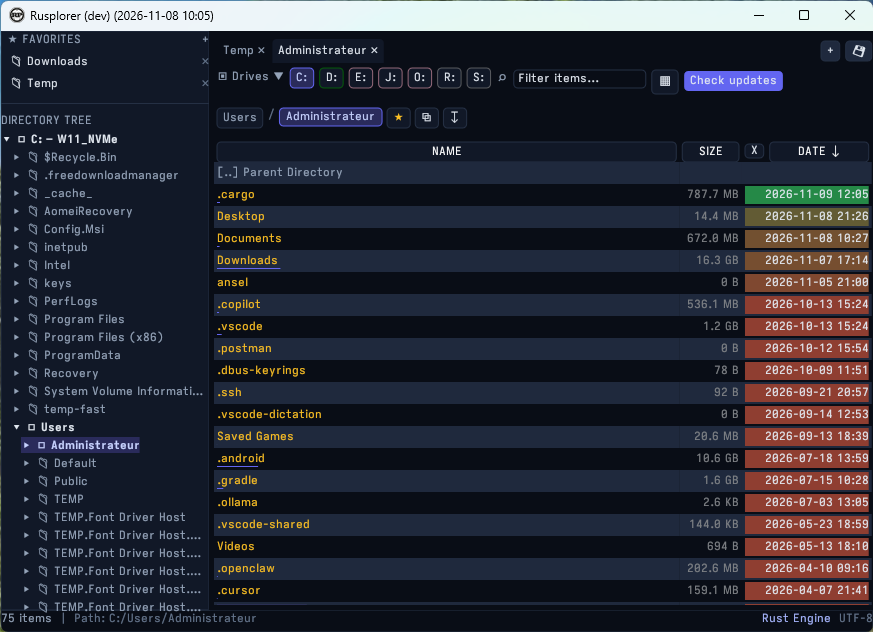

# Rusplorer 🚀

A lightweight, robust, blazingly-fast file explorer written in Rust / egui for Windows.

<div align="center">


<br>



</div>

## ⚡ Key Advantages

### Speed & Performance
- **Super lightweight** - the normal Windows 11 executable stays lean (6.3 MB); a separate compatibility executable (10 MB) includes the renderer needed by older Windows 10 machines without hardware graphics acceleration
- **All folders and file sizes** - Computed lazily and multithreaded, 0 impact on speed and reactivity. Plus, pauses folder size calculation on focus loss
- **Instant directory listing** - Displays folder contents immediately without waiting for file size calculations
- **Background threading** - No UI blocking, ever smooth interaction
- **Minimal overhead** - Built with `egui` and `eframe` for efficient rendering

### Engineer-Friendly Design
- **Functionality first** - No bloat, no fancy animations, just pure functionality
- **Lightweight GUI** - Portable executable, instant startup
- **Multi-drive support** - Easy drive switching with visible drive selector
- **Possibility to save state as .rsess files**

### User Experience
- **No installation (portable)** - Run `rusplorer.exe` on current Windows 11, or `rusplorer_compatibility.exe` on older Windows 10 systems; the config file is created beside the executable
- **Tabs support**
- **Side mouse button support** - Use your mouse back/forward buttons for navigation
- **2.5 column layout** - File names on the left, sizes aligned to the right, with optional modification date column
- **Interactive breadcrumb**

## 🚀 How to run the program

No installation needed.
Choose the executable that matches the target machine:

| Executable | Intended system | Renderer |
| --- | --- | --- |
| `rusplorer.exe` | Latest Windows 11 with a graphics accelerator | Lean OpenGL/Glow build |
| `rusplorer_compatibility.exe` | Older Windows 10 machines without hardware graphics acceleration | Larger WGPU/ANGLE compatibility build |

Both executables are portable and can be placed anywhere. They keep their configuration beside the executable.


## 📋 Features

- ✅ Fast directory browsing
- ✅ View all folders and file sizes (lazy-loaded)
- ✅ Support all kinds of drives (SSD/HDD/USB/Network) with color indications
- ✅ Back/forward navigation with history
- ✅ Mouse button 4/5 support (side buttons)
- ✅ Keyboard navigation (Alt+arrows)
- ✅ Folder/file differentiation with colors
- ✅ 2.5-column layout (names + sizes + optional date)
- ✅ GUI application, no terminal window

## 🛠️ Technical Stack

- **Language**: Rust
- **GUI Framework**: egui + eframe
- **Toolchain**: x86_64-pc-windows-gnu (MinGW)
- **Binary Size**: Compact standalone executable

## 🛠️ Building the two executables

The production script builds both optimized variants:

1. Kills any running Rusplorer instance
2. Builds both optimized production variants
3. Copies `rusplorer.exe` and `rusplorer_compatibility.exe` to the repository root
4. Launches the normal app

```powershell
./source_code/build-prod.ps1
```

To build them manually from the repository root:
```powershell
# Lean Windows 11 build -> source_code/target/release/rusplorer.exe
cargo build --manifest-path source_code/Cargo.toml --release --no-default-features --features lean

# Windows 10 compatibility build -> source_code/target/release/rusplorer.exe
# Copy or rename this output to rusplorer_compatibility.exe when distributing it.
cargo build --manifest-path source_code/Cargo.toml --release --no-default-features --features compatibility
```
